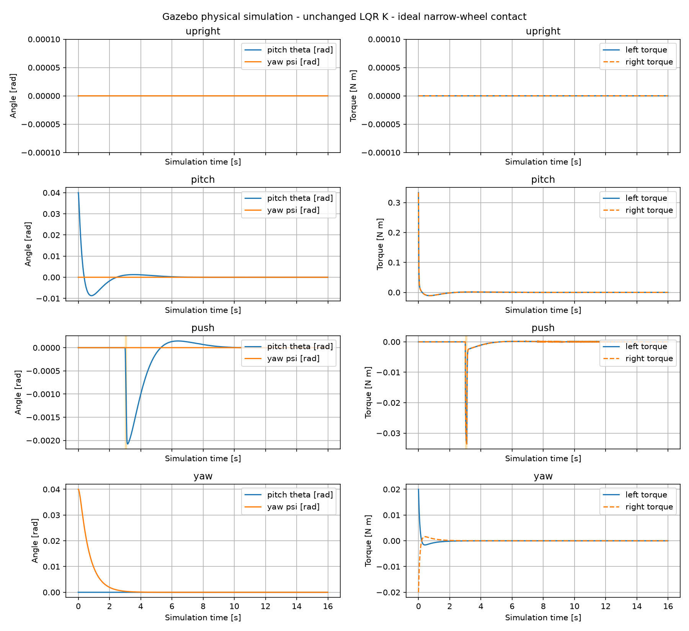

# Gazebo 物理闭环验收记录

日期：2026-09-11。**最终理想窄轮接触模型下，四项局部平衡试验通过。** 数据来自Gazebo刚体运动 → ROS消息 → Python LQR节点 → ros2_control effort的实际闭环，没有用线性方程积分替代物理仿真。

## 结果

每项运行约16仿真秒，K完全复用原导出值，控制频率200 Hz；每轮限幅±1 N·m，四项测试饱和比例均为0。判断窗口为末2秒。

|工况|末2秒最大俯仰绝对值 rad|末2秒最大偏航绝对值 rad|单轮峰值力矩 N·m|六状态收敛|
|---|---:|---:|---:|---|
|静止直立|9.88e-41|7.4e-36|7.694e-35|通过|
|初始俯仰0.04 rad|6.94e-07|7.62e-19|0.333|通过|
|1 N外力持续0.1 s|9.33e-07|1.12e-20|0.03356|通过|
|初始偏航0.04 rad|8.97e-19|9.26e-12|0.02|通过|

六状态全部采用预先写入绘图程序的阈值判定（x 0.01m，psi 0.01rad，theta 0.005rad，三个速度各0.02对应单位）。直立工况为理想对称零扰动，极小输出仅代表数值舍入，不能单独作为抗扰能力证据。



详细六状态图和力矩图：

- [俯仰六状态](results/pitch.states.png)、[俯仰力矩](results/pitch.torques.png)
- [外力六状态](results/push.states.png)、[外力力矩](results/push.torques.png)
- [偏航六状态](results/yaw.states.png)、[偏航力矩](results/yaw.torques.png)
- [直立六状态](results/upright.states.png)、[直立力矩](results/upright.torques.png)

完整数值见 [acceptance.json](results/acceptance.json)，原始数据为同目录四份CSV。外力图橙色区域为请求施力时段；实际记录在该时段出现明显速度/俯仰响应，之后恢复，证实不是只发布了一个未生效的请求。

## effort链路和符号验收

运行时服务返回两项 `left_wheel_joint/effort`、`right_wheel_joint/effort` 均available=true、claimed=true，见各 `*.interfaces.json`。没有加载轮速控制器。

另做独立轮力矩短测：零初始姿态，单轮+0.1 N·m、另轮0，暂时绕过LQR，仿真约0.12秒。以下是10–40 ms速度线性拟合所得初始加速度（用于符号验收，不把接触瞬态拟合当作精确理论参数辨识）：

|输入|xddot m/s²|psiddot rad/s²|thetaddot rad/s²|
|---|---:|---:|---:|
|left +0.1 N·m|0.5954|-1.6704|-1.7829|
|right +0.1 N·m|0.5636|1.5491|-1.6534|

两轮均有正前向、负俯仰响应；左轮负偏航、右轮正偏航，符合既定轴向。这是独立输入对实际Gazebo运动的验证。CSV中的tau列仍是命令值，不应称为力矩传感器实测值。

## 实际排查到的问题

1. **系统组件**：补齐gz_ros2_control/controller_manager/effort控制器后，插件和接口成功加载。
2. **启动时序**：世界先暂停，逐毫秒单步让控制器完成激活，再正式运行，避免等待ROS启动时车体先倒下。
3. **偏航受阻**：初始有限宽圆柱轮碰撞下，0.04rad偏航在16秒后仍约0.0399rad。保持K、质量、惯量、摩擦系数和输入符号不变，仅将碰撞改为同半径球形后，偏航收敛。对照证据明确指向轮地接触表示，而非增益或转轴方向。有限宽接触的转向摩擦/约束阻力与理想窄轮模型不一致；没有进一步从接触力日志分解各接触点的阻力贡献。
4. **退出清理**：原节点在ROS上下文失效后发送零力矩可能报错，现改为先发送零力矩和关闭CSV，再关闭ROS上下文，并让launch只转发一次关停信号。最终left_probe.log确认所有进程正常退出；部分先前试验日志保留了修复前的退出报错，报错发生在完成记录之后。

圆柱碰撞失败记录及曲线位于 [cylinder_contact](results/cylinder_contact)。可用README里的 `--contact cylinder` 复现，未删除或隐瞒失败数据。

## 成功结果的边界

球形collision只是理想窄轮单点接触的几何近似，visual仍为圆柱，两轮continuous joint及薄盘惯量保持原值；并不是把车轮动力学换成实心球。它使当前物理试验与手写模型采用的理想接触假设更接近，但不证明真实有限宽轮胎在同一K下也能实现相同偏航响应。

未观察到持续的大幅力矩振荡；近零阶段仍有微小速度/控制波动。状态速度受位姿差分和平滑影响，因此不能把曲线中约1e-4m/s量级的速度跳动直接解释为真实轮胎振动。每项实际CSV平均采样率约200 Hz，最大采样间隔和末段力矩RMS列于acceptance.json；这不是操作系统硬实时保证。

控制源为 `simulation/outputs/results.json` 中K，完整精度见config/lqr.yaml。状态来源、坐标约定、模型示例参数、每个文件职责和全部启动命令见 [README.md](README.md)。当前全部质量/惯量仍为示例值。

## 如何重跑和汇总

```bash
source /opt/ros/jazzy/setup.bash
cd /home/mechcid/lagarain/ros2_ws
colcon build --symlink-install --packages-select balance_sim
source install/setup.bash
for case in upright pitch push yaw left_probe right_probe; do
  /usr/bin/python3 src/balance_sim/tools/run_case.py "$case" --output results
done
for case in upright pitch push yaw; do
  ../.venv/bin/python src/balance_sim/tools/plot_results.py results/$case.csv
done
MPLCONFIGDIR=/tmp/balance_mpl ../.venv/bin/python src/balance_sim/tools/summarize_tests.py
```

需要看到车模，可用README里的gui:=true启动方式。自动试验默认无GUI，以日志和实际物理状态验收。

## 后续运动控制

前进/后退：增加连续位置/速度参考及相应前馈；偏航：维护参考朝向、角度展开和局部坐标变换，不能直接把大角度状态塞进本静止点K。接实车前需要替换示例参数、验证真实轮胎转向阻力和电机力矩响应，再替换state.py的理想状态来源。本次未引入这些扩展。
