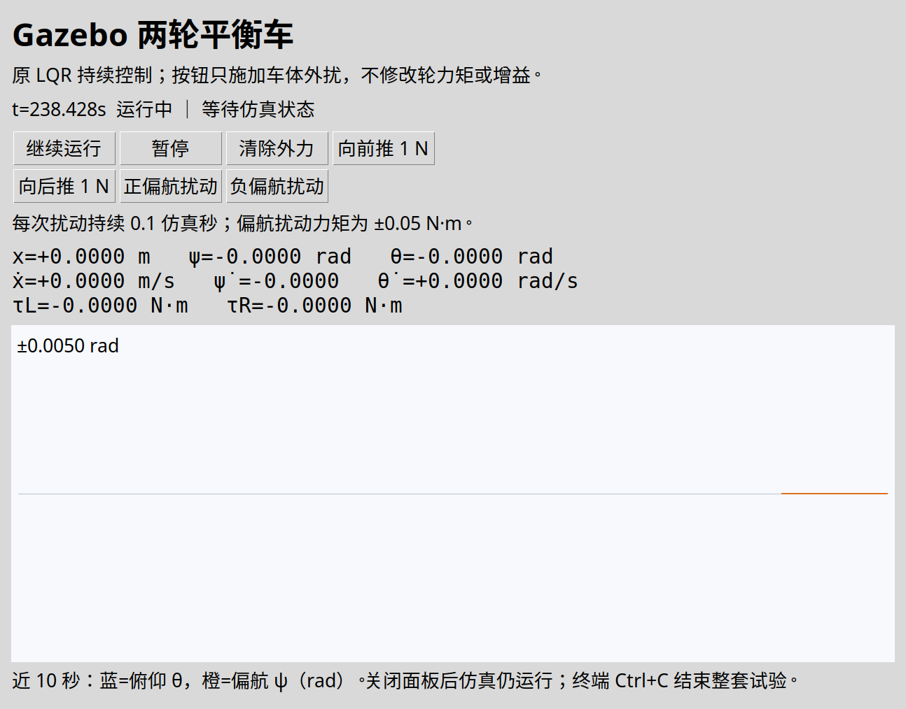

# 六个问题：节点分工、力矩与状态链路、TF，以及交互入口

更新：2026-09-13。本文按你提出的六个问题回答，每条结论都追到当前工程的代码块。旧的总体学习图可参考 [ROS2_PROJECT_ANALYSIS.md](ROS2_PROJECT_ANALYSIS.md)，这里重点解决你读代码时遇到的具体疑问。

**本次实际修改：**保留你新增的换行和注释，去掉Xacro/SDF误混入的Markdown围栏；修正launch中的两处职责注释；补充自动启动就绪节点和独立扰动面板；把state.py剩余的长行拆开。未更改原K、质量、惯量和最终接触假设。

## 先用三条路径消除最容易混淆的地方

```text
轮驱动力矩：balance_lqr → /wheel_effort/commands → wheel_effort
          → ros2_control effort接口 → gz_ros2_control → Gazebo关节

状态反馈：Gazebo IMU/OdometryPublisher → GZ消息 → parameter_bridge
        → ROS /balance/imu、/balance/odometry → state.py → balance_lqr

外部扰动按钮：panel → interaction → ROS wrench话题 → parameter_bridge
            → Gazebo ApplyLinkWrench → 车体外力/外力矩
```

**轮驱动力矩不经过parameter_bridge；传感器和面板外扰经过它。** “都是与Gazebo有关的节点”不意味着它们都在做相同的翻译工作。

## 1. 你对四类节点的划分是否正确？

按“模型、桥接、初始条件、控制”分功能，是合理的第一层理解，但并不与四个独立节点一一对应。最重要的两个修正是：

1. **create同时承担实体生成和初始姿态设置。** 没有另一个仅设置初始姿态的节点。
2. **robot_state_publisher不是Gazebo模型导入器。** 它接收模型描述，发布robot_description，并根据关节状态发布TF。真正把模型送入Gazebo的是create。

此外，你的四类里漏掉了“执行器接口与控制器加载”这一层。spawner就是这层的管理客户端。

|程序/节点|真正职责|不是在做什么|
|---|---|---|
|robot_state_publisher|发布URDF描述；由关节角计算TF|不积分动力学，不在Gazebo创建刚体|
|parameter_bridge|转换ROS和GZ消息/传输|不计算LQR，不替你生成机器人|
|create|读取URDF描述，向Gazebo请求创建实体，并指定初始位置/姿态|不是持续运行的状态估计器；生成后退出|
|spawner|请求controller_manager加载、配置、激活两个控制插件|不是controller_manager本身，也不是LQR|
|balance_lqr|缓存反馈、提取X、计算并发布两轮力矩|不直接操纵Gazebo内部刚体对象|
|gz sim -s / -g|分别运行仿真服务器和图形客户端|不是一个普通用户算法ROS节点|
|新增balance_startup|等待effort就绪，必要时单步，随后解除暂停|只做启动管理，不修改反馈控制律|
|新增balance_interaction|面板的ROS通信端，发外扰和暂停/继续请求|不替代balance_lqr，不占用轮effort接口|

### 1.1 模型描述与创建是两个步骤

源码：[launch/balance.launch.py](src/balance_sim/launch/balance.launch.py)，第15行起（节选）。

```python
desc=xacro.process_file(
    str(p/'description/balance.urdf.xacro'),
    mappings={
        'wheel_contact':arg('wheel_contact')
        }
    ).toxml()
```

源码：[launch/balance.launch.py](src/balance_sim/launch/balance.launch.py)，第34行起（节选）。

```python
Node(package='robot_state_publisher',
     executable='robot_state_publisher',
     parameters=[{'robot_description':desc,'use_sim_time':True}]),
```

这里Xacro先展开为字符串desc，再作为robot_description参数交给robot_state_publisher。节点发布同名描述话题，供create读取。你可以把它看成“准备并发布一份装配描述”，还不是在物理世界实例化。

源码：[launch/balance.launch.py](src/balance_sim/launch/balance.launch.py)，第42行起（节选）。

```python
Node(package='ros_gz_sim',
     executable='create',
     arguments=['-world','balance_world',
                '-name','balance',
                '-topic','robot_description',
                '-z',str(r+0.0001),
                '-P',arg('pitch'),
                '-Y',arg('yaw')],
     output='screen'),
```

真正的实例化在这里：`-topic robot_description`指定模型来源；`-world balance_world`指定世界；`-name balance`指定Gazebo实体名；`-z`、`-P`、`-Y`分别给初始高度、俯仰、偏航。后两者不是对某个轮joint的position赋值，而是设置整个模型的初始姿态。

### 1.2 spawner为何还要单独存在？

源码：[launch/balance.launch.py](src/balance_sim/launch/balance.launch.py)，第52行起（节选）。

```python
Node(package='controller_manager',
     executable='spawner',
     arguments=['joint_state_broadcaster',
                'wheel_effort',
                '--controller-manager-timeout','120'],
                output='screen'),
```

它请求加载joint_state_broadcaster和wheel_effort，而不是生成一个新的控制管理器。controller_manager由Gazebo模型上的集成插件创建；实际闭环运行时它继续存在，spawner完成任务后退出。

所以你注释中的“疑似是gazebo的控制器管理器”应改成“向Gazebo插件内的controller_manager发送加载和激活请求的客户端”。代码中已这样修正。

## 2. 算法计算的力矩究竟怎样作用于刚体？

先区分运动学和动力学：关节定义限定可允许的相对运动；质量、惯量、外力、关节力矩和接触共同决定运动如何随时间变化。当前Gazebo运行的是带这些约束的动力学，不是仅按运动关系播放姿态。

### 2.1 用户算法先生成ROS命令

源码：[balance_sim/controller.py](src/balance_sim/balance_sim/controller.py)，第174行起（节选）。

```python
raw = self.probe if np.any(self.probe) else -self.K @ (X - self.ref)
u = np.clip(raw, -self.limit, self.limit)

self.command(u)
self.debug.publish(Float64MultiArray(data=[*X, *u]))
```

源码：[balance_sim/controller.py](src/balance_sim/balance_sim/controller.py)，第83行起（节选）。

```python
self.pub = self.create_publisher(
    Float64MultiArray, '/wheel_effort/commands', 10
)
```

源码：[balance_sim/controller.py](src/balance_sim/balance_sim/controller.py)，第133行起（节选）。

```python
def command(self, u):
    self.pub.publish(
        Float64MultiArray(data=list(map(float, u)))
    )
```

正常模式probe为零，所以raw就是-K(X-ref)。clip把每轮力矩限制到±limit。消息data顺序严格是 `[tau_L,tau_R]`，单位N·m。

### 2.2 消息由wheel_effort接收，并按关节顺序写接口

源码：[config/controllers.yaml](src/balance_sim/config/controllers.yaml)，第1行起（节选）。

```yaml
controller_manager:
  ros__parameters:
    update_rate: 1000
    joint_state_broadcaster:
      type: joint_state_broadcaster/JointStateBroadcaster
    wheel_effort:
      type: effort_controllers/JointGroupEffortController
wheel_effort:
  ros__parameters:
    joints: [left_wheel_joint, right_wheel_joint]
joint_state_broadcaster:
  ros__parameters:
    use_local_topics: false
```

JointGroupEffortController在这里是“把数组送到effort接口”的控制插件。它没有你的状态矩阵或K，不会再做轮速控制。controllers.yaml中的joints顺序决定数组第0/1项送给哪只轮。

### 2.3 接口如何连接到仿真硬件

源码：[description/balance.urdf.xacro](src/balance_sim/description/balance.urdf.xacro)，第241行起（节选）。

```xml
<ros2_control
    name="GazeboSimSystem"
    type="system">

    <hardware>
        <plugin>
            gz_ros2_control/GazeboSimSystem
        </plugin>
    </hardware>


    <!-- 为一个车轮定义控制接口 -->
    <xacro:macro
        name="interface"
        params="side">

        <joint name="${side}_wheel_joint">

            <command_interface name="effort">
                <param name="min">-5</param>
                <param name="max">5</param>
            </command_interface>

            <state_interface name="position"/>
            <state_interface name="velocity"/>
            <state_interface name="effort"/>

        </joint>

    </xacro:macro>


    <!-- 给左右轮生成控制接口 -->

    <xacro:interface side="left"/>
    <xacro:interface side="right"/>

</ros2_control>
```

源码：[description/balance.urdf.xacro](src/balance_sim/description/balance.urdf.xacro)，第287行起（节选）。

```xml
<!-- ros2_control Gazebo 插件 -->
<plugin
    filename="libgz_ros2_control-system.so"
    name="gz_ros2_control::GazeboSimROS2ControlPlugin">

    <parameters>
        $(arg controllers)
    </parameters>

</plugin>
```

这两个plugin写法分属两层：外层Gazebo系统插件负责进入仿真进程、建立controller_manager和更新循环；ros2_control内部选择GazeboSimSystem作为硬件适配。

`left_wheel_joint/effort`等名字在这里是框架内的数据接口，不是又一个ROS话题。GazeboSimSystem的write路径把当前effort命令写成Gazebo joint的力/力矩命令，物理引擎据此推进。

源码最后一层在上游C++库中，不在我们的Python包里。本机安装了 `libgz_ros2_control-system.so` 和 `libgz_hardware_plugins.so`。可对照 [官方Jazzy分支gz_system.cpp的write实现](https://github.com/ros-controls/gz_ros2_control/blob/jazzy/gz_ros2_control/src/gz_system.cpp)：effort分支使用JointForceCmd，其中的关键赋值是：

```cpp
*jointEffortCmd = sim::components::JointForceCmd(
  {this->dataPtr->joints_[i].joint_effort_cmd});
```

这是上游分支的代码摘录，不声称其行号与本机二进制构建版本逐行一致。它明确展示了“命令槽→Gazebo关节组件”这个接口边界。

对continuous旋转关节，effort表示轴向力矩；施加于轮与车体之间，反作用由关节动力学处理。我们不再单独给车体补一遍负反力矩，否则会重复计入。

**因此：若把中间适配泛称为中间件，可以说存在适配层；若特指parameter_bridge，答案是否定的。** 轮驱动命令的翻译由ros2_control控制插件和gz_ros2_control硬件适配完成。

## 3. x、psi、theta怎样作为传感器消息回到算法？

不是先把一个通用的“Gazebo广义坐标数组”改名为IMU。当前有两种不同来源：

- Gazebo中配置的IMU传感器系统输出姿态和角速度，用于theta、psi及其角速率；这是仿真传感器。
- OdometryPublisher输出模型ground truth位姿/速度，用于x、xdot；这是理想里程计接口，尚未换成真实轮编码器估计。

你纸面上的x、psi、theta这个六状态顺序是我们自己的控制契约，不是Gazebo内置的变量命名。最后组装X的是state.py，不是bridge。

### 3.1 Gazebo侧传感器由谁创建、谁计算

源码：[description/balance.urdf.xacro](src/balance_sim/description/balance.urdf.xacro)，第87行起（节选）。

```xml
<sensor
    name="imu"
    type="imu">

    <always_on>true</always_on>
    <update_rate>1000</update_rate>
    <topic>/balance/imu</topic>

    <imu>
        <orientation_reference_frame>
            <localization>CUSTOM</localization>

            <custom_rpy parent_frame="world">
                0 0 0
            </custom_rpy>
        </orientation_reference_frame>
    </imu>

</sensor>
```

源码：[worlds/balance.sdf](src/balance_sim/worlds/balance.sdf)，第46行起（节选）。

```xml
<plugin
    filename="gz-sim-imu-system"
    name="gz::sim::systems::Imu"/>
```

Xacro中的sensor声明装在哪里、叫什么、更新频率和GZ输出话题；world中的Imu系统负责推进这个传感器。两者不是重复：一个是实例配置，一个是执行该类传感器逻辑的系统。

IMU安装在base_link上，方向与车体轴一致。x不是通过二次积分IMU加速度得到的。

源码：[description/balance.urdf.xacro](src/balance_sim/description/balance.urdf.xacro)，第300行起（节选）。

```xml
<plugin
    filename="gz-sim-odometry-publisher-system"
    name="gz::sim::systems::OdometryPublisher">

    <dimensions>3</dimensions>

    <odom_publish_frequency>
        1000
    </odom_publish_frequency>

    <odom_topic>
        /balance/odometry
    </odom_topic>

    <odom_frame>
        world
    </odom_frame>

    <robot_base_frame>
        base_link
    </robot_base_frame>

</plugin>
```

OdometryPublisher由模型上的插件执行，输出到GZ话题 `/balance/odometry`，位置参考world，子坐标标签base_link。速度来自插件的位姿差分/处理，不应把所有启动帧都理解成完美无瞬态；以前的学习取证已看到首帧异常，这次不把该接口宣称为实车传感器。

### 3.2 bridge只负责两侧消息转换

源码：[config/bridge.yaml](src/balance_sim/config/bridge.yaml)，第1行起（节选）。

```yaml
- direction: GZ_TO_ROS
  gz_topic_name: /clock
  gz_type_name: gz.msgs.Clock
  ros_topic_name: /clock
  ros_type_name: rosgraph_msgs/msg/Clock
- direction: GZ_TO_ROS
  gz_topic_name: /balance/imu
  gz_type_name: gz.msgs.IMU
  ros_topic_name: /balance/imu
  ros_type_name: sensor_msgs/msg/Imu
- direction: GZ_TO_ROS
  gz_topic_name: /balance/odometry
  gz_type_name: gz.msgs.Odometry
  ros_topic_name: /balance/odometry
  ros_type_name: nav_msgs/msg/Odometry
```

配置中GZ和ROS话题恰好同名，但它们属于不同通信系统。parameter_bridge一侧订阅gz.msgs.IMU/Odometry，另一侧发布sensor_msgs/msg/Imu与nav_msgs/msg/Odometry。桥接不求欧拉角、不运行LQR，也不判断你把x定义为哪个方向。

### 3.3 算法节点接收并转换

源码：[balance_sim/controller.py](src/balance_sim/balance_sim/controller.py)，第69行起（节选）。

```python
subscriptions = [
    ('imu', Imu, '/balance/imu'),
    ('odom', Odometry, '/balance/odometry'),
    ('joints', JointState, '/joint_states'),
]
for key, typ, topic in subscriptions:
    self.create_subscription(
        typ,
        topic,
        lambda msg, k=key: self.receive(k, msg),
        qos_profile_sensor_data,
    )
```

源码：[balance_sim/controller.py](src/balance_sim/balance_sim/controller.py)，第152行起（节选）。

```python
X = extract(
    self.data['imu'],
    self.data['odom'],
    self.heading,
)
```

源码：[balance_sim/state.py](src/balance_sim/balance_sim/state.py)，第18行起（节选）。

```python
def extract(imu, odom, heading):
    R = rotation(imu.orientation)
    pitch = math.asin(float(np.clip(-R[2, 0], -1, 1)))
    roll = math.atan2(R[2, 1], R[2, 2])
    yaw = math.atan2(R[1, 0], R[0, 0])
    omega = imu.angular_velocity

    # ZYX欧拉角速率：体轴角速度不能直接当成欧拉角导数。
    pitch_rate = math.cos(roll)*omega.y - math.sin(roll)*omega.z
    yaw_rate = (
        math.sin(roll)*omega.y + math.cos(roll)*omega.z
    ) / math.cos(pitch)

    # 固定名义朝向，而不是当前随车体旋转的前向。
    forward = np.array([math.cos(heading), math.sin(heading), 0.0])
    pos = odom.pose.pose.position
    v = odom.twist.twist.linear
    position = np.array([pos.x, pos.y, pos.z])
    local_velocity = np.array([v.x, v.y, v.z])

    # OdometryPublisher的twist用子坐标系分量；先转回world。
    world_v = rotation(odom.pose.pose.orientation) @ local_velocity
    yaw_error = math.atan2(math.sin(yaw-heading), math.cos(yaw-heading))

    return np.array([
        forward @ position,
        yaw_error,
        pitch,
        forward @ world_v,
        yaw_rate,
        pitch_rate,
    ])
```

这里可以直接看到你熟悉的运算：四元数生成旋转矩阵，提取姿态角；体轴角速度转换为欧拉角速率；里程计局部速度转回world，再投影到固定名义前向。

对应关系为：

|控制量|直接数据源|处理者|
|---|---|---|
|x|Odometry pose.position|state.py按固定heading投影|
|psi、theta|IMU orientation|state.py转换并相对名义朝向取偏差|
|xdot|Odometry twist.linear|state.py旋回world后投影|
|psidot、thetadot|IMU angular_velocity|state.py做体轴速度到欧拉角速率转换|
|轮角/轮速|joint_state_broadcaster发布的JointState|目前仅就绪检查和CSV记录|

移植时主要替换状态来源及外参处理，保留最终六状态的物理意义。只保持同一个消息类型还不够，frame、单位、时间戳和参考点也必须一致。

## 4. 为什么创建一个可控制模型要这么多步？

因为“一个机器人”在软件里同时涉及几份不同契约。把这些操作分开，不是同一件事做了四次。

|步骤|实际配置/调用源|解决的问题|
|---|---|---|
|定义机械装配|Xacro中的link/joint/inertia/collision|这个机械系统由什么组成|
|提供模型与正运动学|launch启动robot_state_publisher|让ROS消费者获得URDF和TF|
|创建物理世界|launch执行gz sim -s，world SDF|重力、地面、接触及物理求解在哪里运行|
|实例化机器人并设置初态|create的-topic/-z/-P/-Y|将描述变成某个world里的实体|
|导出执行器与反馈接口|Xacro中的ros2_control及Gazebo插件|哪个joint能写effort、能读什么状态|
|加载活动控制插件|controllers.yaml + spawner|哪个controller获得哪些接口的使用权|
|把GZ状态带入ROS|bridge.yaml + parameter_bridge|跨两套传输系统搬运传感器消息|
|运行自己的算法|controller.py|依据当前X给出u|

其中有些是文件解析，有些是Gazebo进程内插件，有些才是单独的ROS节点。节点数量不能直接当作机械系统层次数量。

世界和模型的创建步骤在源码中分别是：

源码：[launch/balance.launch.py](src/balance_sim/launch/balance.launch.py)，第27行起（节选）。

```python
gz=['gz','sim','-s','-v','3',str(p/'worlds/balance.sdf')]
actions=[ExecuteProcess(cmd=gz,output='screen')]
if arg('gui')=='true': 
    actions.append(ExecuteProcess(cmd=['gz','sim','-g'],output='screen'))
```

源码：[description/balance.urdf.xacro](src/balance_sim/description/balance.urdf.xacro)，第193行起（节选）。

```xml
<joint
    name="${side}_wheel_joint"
    type="continuous">

    <parent link="base_link"/>
    <child link="${side}_wheel"/>

    <origin xyz="0 ${sign * p['d'] / 2} 0"/>

    <axis xyz="0 1 0"/>

    <limit
        effort="5"
        velocity="100"/>

    <dynamics
        damping="0"
        friction="0"/>

</joint>
```

上面关节配置指定parent/child、轴心偏移和+ y轴；这个装配信息之后同时被物理引擎和正运动学使用。它不能代替“谁向effort接口写值”，所以仍需要控制层。

想理解启动顺序，可以用以下因果链，不要简单按launch列表的文本顺序理解为同步完成：

```text
展开Xacro → robot_description可读取 → create生成实体
→ Gazebo加载控制集成 → controller_manager服务出现
→ spawner请求加载并激活 → 确认两轮effort被认领
→ 解除暂停 → clock及传感器推进 → LQR持续反馈
```

以前自动测试脚本run_case处理了最后的等待和单步，而直接launch没有完整处理。此次新增startup节点把这项工作补到交互启动路径，避免你必须在GUI反复单步才等到控制器激活。

## 5. 为什么没有看到TF及手推的全部变换矩阵？

TF没有消失，也没有替Gazebo计算动力学；它只是一条当前控制节点不消费的运动学支路。

### 5.1 变换关系的一部分以装配参数存在

robot_state_publisher读取joint的origin、axis和实时joint angle，内部执行正运动学。例如左轮这条边相当于：

\[
{}^{base}T_{left}=\operatorname{Trans}(0,d/2,0)\operatorname{Rot}_y(q_L).
\]

你没有在用户Python脚本中再展开每个正弦余弦，是因为这部分标准正运动学由robot_state_publisher执行。Gazebo物理内部也维护自己的刚体姿态，并不依赖ROS TF才能运行。

**当前base_link原点在车轴中心，但姿态随车体俯仰；它不是纸面上仅随偏航的C系。** 轮关节角相对车体，因此同轴约定下q_L=theta_L-theta、q_R=theta_R-theta。车体质心由inertial origin描述，不自动生成Bo这个TF frame。

### 5.2 TF的真实生产者和消费者

```text
Gazebo关节状态 → GazeboSimSystem state interfaces
→ joint_state_broadcaster → /joint_states
→ robot_state_publisher → /tf
                         ├─ base_link → left_wheel
                         └─ base_link → right_wheel
```

这是此前实际 `/tf`取证观察到的两条边，原文见 [learning_evidence/tf.json](learning_evidence/tf.json)。当前模型没有world→base_link的ROS TF，也没有单独的C、Bo和IMU外参TF；Odometry带world/base_link标签不等于它自动广播TF。

balance_lqr订阅的是IMU、Odometry、JointState，没有订阅tf2；它直接在state.py里用姿态矩阵转换速度。因此当前闭环不需要补一整套TF框架才能站稳。以后接多个有相对安装角的传感器，或用RViz以world为参考显示时，TF和外参链才会进入你的状态处理流程。

### 5.3 手推的动力学矩阵在哪里

M0、K0等主要在theory/与simulation/中，用于得到K；当前控制节点加载的是最终K。Gazebo不在每一步重算你的拉格朗日表达式。它从URDF/SDF中的刚体、关节、惯量和接触数据独立推进状态，所以不应期待在ROS控制代码中又出现一遍完整手写动力学推导。

## 6. 这次不能运行/没有交互入口的具体原因和修复

### 6.1 文件格式问题：不是换行或注释本身

发现两个文件都被包进了Markdown代码围栏：

- description/balance.urdf.xacro
- worlds/balance.sdf

原文件第一行是三个反引号加xml，最后一行是三个反引号。这种写法用于在Markdown里展示XML，不能保留在真正的XML文件中。对world运行 `gz sdf -k` 得到XML_ERROR_PARSING_DECLARATION。

已去掉这两处首尾围栏，保留内部换行与中文注释。修复前文件完整备份在 [originals](results/review_0913/originals/)。修复后Python编译检查、Xacro展开、参数/轴向检查和SDF校验通过。

XML内部自由换行一般没有问题；属性值要保留在引号内；Python的缩进则有语法意义。今后从Markdown复制代码到源文件，只复制围栏里面的内容。

### 6.2 直接launch缺少就绪处理

原脚本只启动暂停世界和spawner。管理器切换控制器时可能等待一次物理更新；如果世界一直暂停，就会形成启动等待。原run_case已通过单步处理，但手动launch没有包含这项能力。

新增 [startup.py](src/balance_sim/balance_sim/startup.py)：使用墙钟timer等待服务，在暂停期间限量逐毫秒推进，确认两个controller active以及两个effort available/claimed后自动解除暂停。特别处理了管理器切换时ListControllers响应可能也在等待的问题：不能等这个查询返回后才允许单步。

源码：[launch/balance.launch.py](src/balance_sim/launch/balance.launch.py)，第67行起（节选）。

```python
if arg('auto_start') == 'true':
    actions.append(Node(package='balance_sim', executable='startup', output='screen'))
if arg('panel') == 'true':
    actions.append(Node(package='balance_sim', executable='interaction_panel', output='screen'))
return actions
```

这里是新增两个功能的实际入口。auto_start和panel都可关闭；批量测试明确传入gui=false、panel=false、auto_start=false，由原run_case监督流程管理，避免两个启动监督者同时控制world。

### 6.3 缺少交互按钮：以前只有预设自动测试

原外力实验由controller.py中 `t>=3` 分支自动施加；不是可以随时点击的操作界面。Gazebo GUI用于场景显示和基础仿真操作，不会自动给你的LQR项目生成“推一下车体”按钮。

现在新增独立面板，提供：

|按钮|实际操作|
|---|---|
|暂停/继续|调用Gazebo world control；暂停前清除面板外力|
|向前/向后推1 N|车体施加world ±x方向力，持续0.1仿真秒|
|正/负偏航扰动|车体施加world ±z方向0.05 N·m外力矩，持续0.1仿真秒|
|清除外力|移除该车体的持续外力请求|

这些是外部扰动，不是直接给两个电机额外力矩，也不是偷偷调K。

实际代码路径：

源码：[balance_sim/interaction.py](src/balance_sim/balance_sim/interaction.py)，第61行起（节选）。

```python
msg = EntityWrench()
msg.entity.name = 'balance::base_link'
msg.entity.type = Entity.LINK
if axis == 'x':
    msg.wrench.force.x = magnitude
else:
    msg.wrench.torque.z = magnitude
self.wrench.publish(msg)
self.until = self.sim_time + duration
self.status = f'已请求 {axis} 扰动 {magnitude:+g}，持续 {duration:g} 仿真秒'
self.get_logger().info(self.status)
```

源码：[balance_sim/interaction.py](src/balance_sim/balance_sim/interaction.py)，第89行起（节选）。

```python
def maintenance(self):
    if self.until is not None and self.sim_time >= self.until:
        self.clear_force()
```

面板的ROS节点使用墙钟处理界面及服务响应，而脉冲期限使用/clock的仿真时间。这样仿真变慢不会改变所请求的物理作用时长。暂停、结束脉冲和关闭面板都会请求clear，避免正常交互中残留持续外力。进程被强制杀死仍不能保证发出清除请求；本面板不是安全级硬件接口。

面板还显示六状态、两轮力矩、仿真时间和近10秒的theta/psi曲线。关闭面板不会结束Gazebo；在启动终端Ctrl+C结束整套试验。

### 6.4 这次调试中另外遇到的环境和界面问题

- 我的第一次图形测试进程没有继承DISPLAY，导致Qt/Tk无法连接显示；重试时使用当前桌面的DISPLAY/XAUTHORITY后窗口正常。这是该测试进程的环境问题，不是你的换行导致，也没有在代码里硬编码你的显示号。
- 高DPI桌面中固定700×510窗口会裁切大字体和曲线；已让窗口大小随Tk DPI缩放。
- 新的startup初版在等待查询返回时也可能卡住，我已在本轮修正并实际验证；不归因于你的文件整理。

## 7. 现在怎样直接使用

第一次或代码更新后构建：

```bash
source /opt/ros/jazzy/setup.bash
cd /home/mechcid/lagarain/ros2_ws
colcon build --symlink-install --packages-select balance_sim
```

从图形桌面的终端执行：

```bash
/home/mechcid/lagarain/ros2_ws/run_interactive.sh
```

它设置当前进程的ROS环境和独立的日志目录，启动Gazebo、扰动面板与自动就绪流程。默认初始俯仰0.03rad，先观察它站稳，再点击扰动按钮。点击顺序不限，但同一个扰动未结束时需要等待或先清除。

也可直接运行原生ROS入口：

```bash
source /opt/ros/jazzy/setup.bash
source /home/mechcid/lagarain/ros2_ws/install/setup.bash
ros2 launch balance_sim balance.launch.py gui:=true panel:=true auto_start:=true
```

无桌面时用于后台验证：

```bash
/home/mechcid/lagarain/ros2_ws/run_interactive.sh gui:=false panel:=false
```

不要同时开多个同名world和同名ROS节点做对账；自动测试已有隔离方式，日常交互建议先关闭前一次启动。

## 8. 验证结果与边界

- 已实际显示Gazebo与Tk面板，并从直接launch自动进入运行状态。
- 用真实Tk按钮的invoke回调驱动真实Gazebo完成暂停、继续、前后推、正负偏航和clear测试，不是仅检查按钮对象是否存在。
- 暂停期间时钟停止，继续后时钟推进；四次扰动均有可观测响应，6仿真秒后回到测试阈值内，脉冲已清除。具体数值见 [buttons.json](results/review_0913/buttons.json)。
- 仍使用此前的示例参数、原K与理想窄轮sphere碰撞。没有证明真实宽轮轮胎或大范围运动也满足同样结论。
- 原来的world→base_link TF缺口、状态时间同步、参数热更新等问题没有假装已经解决；它们与本次交互入口是不同任务。



## 9. 本次新增文件的职责

|文件|职责|
|---|---|
|balance_sim/startup.py|启动阶段服务/接口就绪和单步，不计算力矩|
|balance_sim/interaction.py|面板的ROS通信与外扰期限管理|
|balance_sim/panel.py|Tk显示、按钮、实时状态曲线|
|tools/test_interaction.py|已运行的按钮到Gazebo集成测试|
|run_interactive.sh|一条命令设置环境并启动，日志写入新的结果目录|
|本Markdown|六个问题的源码解释、修改原因和操作说明|

主体控制仍在controller.py，状态转换仍在state.py。没有把GUI回调塞进LQR控制定时器，也没有改变力矩控制为轮速控制。
