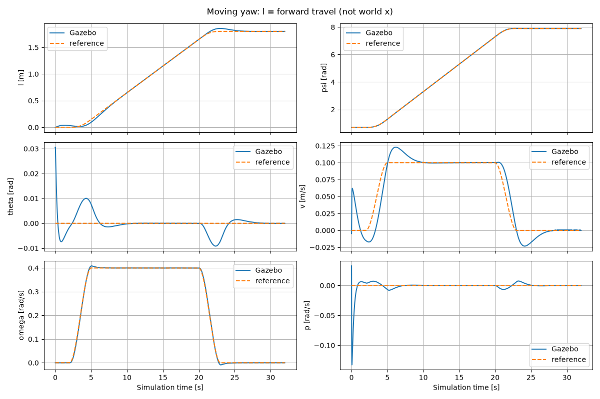
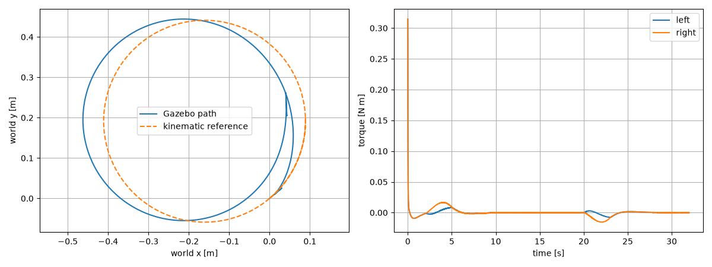

# 持续偏航运动分支：l—psi—theta

本分支实现“边前进、边改变朝向，同时保持直立附近的平衡”。旧 `balance_sim` 的控制节点、静止点launch、理论文件与验收数据保留；新入口为独立ROS包 `balance_yaw`。这里的“分支”是独立目录/包/启动入口，未创建或声称已有Git分支。

## 最重要的符号切换

- 旧独立变量x是世界坐标位移。新独立运动变量 **l** 是累计前向行程，`l_dot=v`。
- 世界位置是输出：`x_dot=v*cos(psi)`、`y_dot=v*sin(psi)`。转弯时l不等于x，不能把x读数直接填到l的位置。
- 旧物理参数文件的`l=0.30`表示质心高度。新理论叫 **l_c**，数值模型的键叫 **com_height**，在适配边界从旧physical.yaml读取；绝不把它当成运动坐标。
- 用户本次所说的phi，代码继续沿用 **psi**，避免和旧轮转角命名混淆。
- 新状态严格为 `[l, psi_unwrapped, theta, v, omega, p]`，即 `[l,psi,theta,l_dot,psi_dot,theta_dot]`。

psi通过相邻姿态差展开，不在±π突然跳变；l使用当前朝向上的车体前向速度积分。坐标中没有除cos(psi)，可穿过90°和270°。

## 新旧部分放在哪里

|路径|作用|
|---|---|
|`../theory/yaw_motion/README.md`|含持续偏航耦合项的完整公式与符号对应|
|`../theory/yaw_motion/derive.py`|精确六坐标能量、拉格朗日算子和非完整投影|
|`../theory/yaw_motion/derivation.ipynb`|已执行、可渲染阅读的新笔记本|
|`../simulation/yaw_motion/design_and_check.py`|移动参考线性化、CARE、新K、旧模型回归、非线性数值积分|
|`../simulation/yaw_motion/check_projection.py`|独立9×9乘子法随机数值对照|
|`src/balance_yaw/balance_yaw/dynamics.py`|数值M、h、输入映射、雅可比、平滑参考|
|`src/balance_yaw/balance_yaw/controller.py`|ROS状态提取、行程积分、偏航展开、力矩反馈与记录|
|`src/balance_yaw/config/yaw.yaml`|新移动参考K与速度、频率、限幅参数|
|`src/balance_yaw/launch/yaw.launch.py`|独立新入口；复用旧刚体模型、桥接、effort配置和启动握手|
|`src/balance_yaw/tools/run_turn.py`|四组物理试验与接口证据|
|`src/balance_yaw/tools/analyze.py`|新六状态、世界XY路径、力矩及验收指标|
|`results_yaw/`|仅本分支的新数据；old_branch_regression内是旧分支回归结果|
|`run_yaw.sh`|打开GUI运行新分支，创建独立日志目录|

旧 `balance_sim/controller.py` 和旧K没有被新控制器覆盖。两个控制器不能在同一ROS域中同时向同一个车发力矩。自动新测试使用ROS_DOMAIN_ID=74、独立GZ_PARTITION；旧自动测试使用73。

## 公式到控制器的衔接

完整推导见 [理论说明](../theory/yaw_motion/README.md)。新模型为

\[
M(\theta)\dot u+h(\theta,v,\omega,p)=B_\tau\tau,\qquad u=(v,\omega,p)^T.
\]

不把静止点的所有速度都置零，而是以 `v0=0.10 m/s, omega0=0.40 rad/s, theta0=0` 的移动参考求扰动模型。转向项包含theta与omega²、v·omega的耦合。沿用原Q=diag(10,5,400,5,2,40)、R=diag(10,10)，通过CARE重新算该运动附近的K。

新K约为：

```text
[[-0.70724568, -0.49990177, -8.33396812, -1.37597082, -0.36134182, -2.04371018],
 [-0.70696786,  0.50009821, -8.34360125, -1.37545287,  0.36149977, -2.04368501]]
```

完整精度在yaw.yaml和design.json中。反馈为 `tau = clip(-K @ (X-X_ref), -1, 1)`，200Hz；依然使用左右轮effort，而非轮速控制器。

当前使用同一组设计K验证正向/反向转弯和固定朝向，不声称它在所有速度下都是最优LQR。状态姿态仍限定直立附近；任意大偏航角可以通过，但高速转向/大俯仰/侧翻不属于本次验证范围。

## 默认运动程序

|仿真时间（有效状态起算）|参考运动|
|---|---|
|0～2秒|原地回稳；初始theta=0.03rad|
|2～5秒|平滑起步，v升至0.10，omega升至0.40|
|5～20秒|保持前进和持续转向|
|20～23秒|平滑减速、停止转向|
|23秒以后|保持最终行程和展开后的朝向，继续平衡|

完整程序累计l_ref=1.8m、偏航变化7.2rad（超过一整圈），名义转弯半径约0.25m。默认起始朝向0.7rad，因此终点展开朝向约7.9rad。

第一版没有加加速度前馈；平滑起停允许暂态误差。它是行程/朝向参考跟踪，**不是使用世界XY位置误差闭环的全局轨迹控制**。绘图中的参考XY曲线仅由参考速度和朝向积分供对照，不能把它当作已实现独立XY跟踪器。

## 运行

先构建一次（不用安装新依赖）：

```bash
source /opt/ros/jazzy/setup.bash
cd /home/mechcid/lagarain/ros2_ws
colcon build --symlink-install --packages-select balance_yaw
source install/setup.bash
```

GUI查看默认转弯：

```bash
cd /home/mechcid/lagarain/ros2_ws
./run_yaw.sh
```

其他已有验收工况：

```bash
./run_yaw.sh yaw:=-1.1 yaw_rate:=-0.4
./run_yaw.sh yaw:=1.2 yaw_rate:=0.0
./run_yaw.sh disturbance:=true
```

无GUI自动测试和绘图：

```bash
/usr/bin/python3 src/balance_yaw/tools/run_turn.py turn --output results_yaw
/usr/bin/python3 src/balance_yaw/tools/run_turn.py reverse --output results_yaw
/usr/bin/python3 src/balance_yaw/tools/run_turn.py fixed_heading --output results_yaw
/usr/bin/python3 src/balance_yaw/tools/run_turn.py turn_push --output results_yaw
../.venv/bin/python src/balance_yaw/tools/analyze.py results_yaw/turn.csv
```

工具按顺序运行，不并行；物理步长、摩擦、质量、惯量仍复用旧模型。GUI入口已提供，物理验收采用无GUI模式，不将“窗口能显示”当作闭环验收。

旧分支仍可使用原 `run_interactive.sh` 或 `ros2 launch balance_sim balance.launch.py`。

## 状态读取与记录

IMU计算yaw/pitch及角速率；odom速度旋回世界后，再投影到当前水平heading，而不是初始heading。使用梯形积分更新l。启动先跳过极早期odom差分样本，消息失新则置零；pitch超过0.5rad或roll超过0.25rad时停止继续控制。

CSV保存六状态、六参考、world x/y、roll、横向速度、左右力矩、饱和标志和传感器年龄。转弯扰动测试在12秒沿当时车头前向施加1N、持续0.1s，再移除；不是一直沿world x推。

## 边界和以后修改时应注意的事

1. 与旧验收一致，使用球形collision代表理想窄轮点接触；不是精确的宽轮胎模型。roll被物理仿真记录，但理论未增加roll自由度；低速小侧向加速度下验证通过不代表高速不会侧翻。
2. 新公式显式假设左右轮对称且轴对称。实车左右参数不同时，应回到六坐标能量重新投影，不把本公式直接套用。
3. 物理参数中的l未改文件名/键，是为了不破坏旧分支。新分支的参数适配和文档必须保留，切勿将CSV行程l与质心高度混用。
4. 持续速度和heading参数在节点启动时读取；没有实现在线热更新控制参数、轨迹消息接口或实时重新设计K。
5. 行程积分有漂移，真实机器人需要编码器/融合状态等替代；当前是Gazebo理想反馈验证。
6. 限幅、消息检查不是实车硬件watchdog；本工程不作硬件安全保证。

## 本次实际验收（2026-09-16）

所有新试验运行约32仿真秒，末3秒检查六状态误差。正转、反转跨过±π和90°方向，转弯受扰测试在12秒触发实际Gazebo外力。每项都记录了两个effort接口的available/claimed状态。

|工况|累计偏航变化 rad|末段最大行程误差 m|末段最大偏航误差 rad|峰值单轮力矩 N·m|结果|
|---|---:|---:|---:|---:|---|
|turn|7.200000|0.000836|2.69e-06|0.3147|通过|
|reverse|-7.200000|0.000834|1.71e-06|0.3147|通过|
|fixed_heading|-0.000000|0.000839|2.21e-06|0.3147|通过|
|turn_push|7.200000|0.000836|2.69e-06|0.3147|通过|

四项饱和比例均为0，最大俯仰约0.0307rad（包括初始0.03rad扰动），未越过0.12rad验收界限。恒速窗口速度/角速度与参考一致，起停阶段存在可见暂态超调；精确阈值与每项误差见`results_yaw/*.metrics.json`。

旧分支独立回归也通过：`results_yaw/old_branch_regression/pitch.metrics.json`中converged=true，峰值力矩约0.333N·m，旧文件和原验收目录未被覆盖。

数学校验：约束零空间、能量功率恒等式、30组随机6坐标乘子法对照（最大加速度差约3.6e-15）；移动参考雅可比有限差分一致；零速度A/B/K回归原分支；三组精确非线性数值积分均通过。笔记本已执行，无错误单元。





注意世界轨迹图中实际曲线与名义圆轨迹有偏移。起停速度误差在不断变化的朝向上积分后，世界位置不会仅靠最终行程误差归零而自动回到名义XY终点；`final_xy_reference_offset_m`单独记录该差异。本分支没有隐藏这一偏移，也没有把它计为已完成的全局位置跟踪。

其他结果：[反转](results_yaw/reverse.states.png)、[固定非零朝向](results_yaw/fixed_heading.states.png)、[转弯受扰](results_yaw/turn_push.states.png)。
