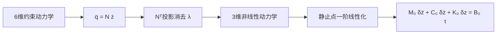

# 非轴对称电机分支：完整车体惯量、精确动力学与局部 LQR

当前分支为 `dissymmetry_motor`，从 `master` 分出；原分支保留无惯性积模型。本分支保留完整车体质心惯量，质心仅保留高度，控制矩阵从精确动力学在可行参考上求导。

先看 `base.ipynb`，然后按场景阅读 `lagrange.ipynb → lqr.ipynb`。笔记本已执行，公式下方是实际计算结果，不必先运行才能阅读。

## 1. 结构和计算依赖

```text
theory/
├── README.md                       本说明
├── base.py                         唯一的位姿、速度、角速度及精确能量源
├── base.ipynb                      相邻变换和 N 系速度的展开公式
├── lagrange_utils.py                显式 EL 算子、乘子法、正确的无乘子投影
├── parameters.py                   读取现有参数、数值代入、CARE 公共函数
├── straight_balance/
│   ├── lagrange.py / lagrange.ipynb 静止直立附近，两种拉格朗日形式及 M0/C0/K0/B0
│   └── lqr.py / lqr.ipynb           六状态 A/B、J、P、K 和闭环极点
├── turning_balance/
│   ├── lagrange.py / lagrange.ipynb 任意偏航：精确动力学及小俯仰展开
│   └── lqr.py / lqr.ipynb           七状态轨迹误差、时变世界矩阵、旋转误差 LQR
├── kane/                           历史凯恩方法实验，独立隔离
├── refresh_notebooks.py             生成并执行五本当前笔记本
├── update_notebooks.sh              使用项目 .venv 的一键入口
├── validate.py                     独立数值/符号校验
└── validation.json                 最近一次校验实测结果
```

依赖链：`base.kinematics() → base.energies()/constraints() → 场景 lagrange.build() → 场景 lqr.design()`。

- `base.py` 不依赖任何场景；位姿和速度只定义一次。能量也是从这些速度和惯量计算，不另写一套独立的机器人运动学公式。
- `lagrange_utils.py` 避免两个场景分别复制六坐标求导与消元代码。每个场景自行选择近似、约束和独立速度。
- `.py` 是计算源；`.ipynb` 是可重建的解释和公式展示。需要永久修改计算时改对应 `.py`；需要永久修改笔记本文字时改 `refresh_notebooks.py`。重建会覆盖对生成笔记本的手工修改。
- 重构前全部文件保存在 `../archive/theory_before_refactor_20260917/`，包括原始笔记本和用户编辑。可以从该目录逐文件恢复。当前理论目录不再保留重复的旧主入口。

## 2. 一键更新笔记本

在项目根目录执行：

```bash
./theory/update_notebooks.sh
```

也可以从任意目录执行：

```bash
/home/mechcid/lagarain/theory/update_notebooks.sh
```

它使用 `/home/mechcid/lagarain/.venv/bin/python`，依次生成、执行五本笔记本；只有五本都执行成功后才开始替换正式文件。临时内核绑定该解释器，不依赖系统 Python 或默认 kernel 的包版本。不会安装包、改系统配置或启动仿真。`--no-execute` 可只生成，但这种输出不包含校验后的公式结果。

额外校验：

```bash
.venv/bin/python theory/validate.py
.venv/bin/python simulation/check_matrix_source.py
.venv/bin/python simulation/yaw_motion/check_projection.py
```

单独查看增益数值：

```bash
PYTHONPATH=theory .venv/bin/python -m straight_balance.lqr
PYTHONPATH=theory .venv/bin/python -m turning_balance.lqr
```

打开入口：

```bash
.venv/bin/jupyter lab theory/base.ipynb
```

## 3. 坐标、原点和符号

关系树是 `N → C → B / WL / WR`。`R_parent_child` 将子坐标分量变成父坐标分量；齐次矩阵的平移列在父系中表达。相邻的变换、角速度反对称矩阵以及各刚体在 N 系下的速度，均在 `base.ipynb` 展开。

保留用户现有代码的原点约定：N 的原点位于名义车轴高度平面，车轴中点 `Co=[x,y,0]`，地面为 `z=-r`。不是把车轴放到地面。`Lo-Co=+d/2 C.y`，`Ro-Co=-d/2 C.y`，`Bo-Co=l B.z`。Gazebo 中模型相对于地面的生成高度是另一回事。

| 符号 | 当前含义 |
|---|---|
| `x,y` | 车轴中心在 N 系中的水平位置 |
| `psi` | C 相对 N 的偏航；正向绕 N.z |
| `theta` | B 相对 C 的俯仰；正向绕 C.y |
| `theta_L,theta_R` | 两轮相对 C 的转角；正向绕 C.y |
| `l` / Python `l` | 车体质心到车轴的距离；旧参数文件仍叫 `l`，在参数接口明确映射 |
| 行程 `s` | 累计前向行程，`ds/dt=v`；不是 N 系的 x，旧版行程 l 改为 s |
| `v` | 前向速度，`xdot=v cos(psi)`、`ydot=v sin(psi)` |
| `omega,p` | 偏航角速度、俯仰角速度 |

七状态转向分支按已确认方案采用 `[x,y,psi,theta,v,omega,p]`。因此不会把世界 `xdot` 与前向速度混在一起，也没有世界 x 速度参数化在 `cos(psi)=0` 处的奇点。姿态角在局部误差计算中应保持连续；不能把跨越 ±π 的角度跳变当成真实误差。

## 4. 两个场景的近似不同

### straight_balance：固定名义朝向、静止直立附近

名义速度为零，`psi=psi_0+delta_psi`，`theta=delta_theta`。保留能量的二阶扰动项、动力学的一阶扰动项，约束也在同一参考点冻结。这里的“无偏航运动”指无名义偏航，不是删除小偏航扰动与控制通道。前进/后退可以在这个局部模型中通过位置参考变化处理，但它不是任意速度、任意范围的运动模型。

精确 T、V 仍在笔记本显示，后续静止分支使用 T2、V2。

最终状态顺序仍为 `[x,psi,theta,xdot,psidot,thetadot]`。为保持已有数值仿真兼容，x 是**世界 x 位移扰动**：M00 含 `sec²(psi_0)`，M01/M02 和输入首行含 `sec(psi_0)`；要求 `cos(psi_0) != 0`。默认 `psi_0=0` 时与名义前向位置一致。

结果为 `M0 zdd + C0 zd + K0 z = B0 tau`。笔记本逐项显示四个矩阵及对应一阶 A、B 的符号值和数值。

### turning_balance：允许持续偏航

psi 与偏航速度不作小量。当前保留原转向模型的假设：左右轮相同且轴对称；若修改左右参数不相等，LQR 参数入口会报错，不能偷偷平均。

从共用精确能量得到六坐标 EL，再投影得到精确 `M(theta) udot+h(theta,u)=Btau tau`。之后对 `(theta,p)` 同阶展开，只保留一阶；v、omega 不缩放，因此 `theta*omega²`、`theta*v*omega` 保留。精确矩阵与近似矩阵均展示，不把“只有俯仰小”误解成所有速度和姿态都很小。

小俯仰动力学仍是非线性的：`h_small` 含速度乘积。因此七状态的世界模型写作 `Zdot=f(Z,tau)`，只有**相对指定可行参考轨迹**的扰动才能写为 `delta_Zdot=A_w(t)delta_Z+B_w delta_tau`。

本版 LQR 使用已有示例 `v0=0.1 m/s, omega0=0.4 rad/s` 的匀速圆周参考，现在由精确方程求 `theta_r, tau_r`，不再假定二者为零。以 `h3+r*h1=0` 求直立附近的俯仰角，再从前向和偏航方程恢复左右轮力矩，并检查三个方向的残差。参考偏航随时间增长，不固定为0。加减速、变化曲率的参考需要重新处理参考力矩和时变线性化，不能直接套这组常增益。

## 5. 两种拉格朗日形式具体在哪里

`lagrange_utils.derive()` 按六坐标先计算：

$$M_6=\frac{\partial^2T}{\partial\dot q^2},\quad
h_6=\frac{\partial}{\partial q}\left(\frac{\partial L}{\partial\dot q}\right)\dot q-\frac{\partial L}{\partial q}.$$

第一类是六方向的 `M6 qdd+h6=B6 tau+Ac.T lambda`，联合约束导数形成9×9方程。笔记本显示 M6、h6、B6、Ac、增广矩阵和右端项。两个电机对车体的反作用力矩包含在 B6 中。

第二类采用无乘子拉格朗日—达朗贝尔形式。选 `qdot=S(q)u`，则：

$$\frac{d}{dt}(S^Tp_q)-S^T\frac{\partial L}{\partial q}-\dot S^Tp_q=S^TB_6\tau,\qquad p_q=\frac{\partial L}{\partial\dot q}.$$

它保留非完整约束所需的修正，不是直接给约束代入后的 L 套普通三坐标 EL 算子。代码分别用此动量形式和第一类投影形式得到 M、h，并断言完全一致。三方向的输入矩阵由虚功 `Btau=S.T B6` 得到；前向力矩驱动没有被丢掉。

## 6. LQR 笔记本中 J、P、K 的关系

两本 `lqr.ipynb` 都从性能指标开始展示：

$$J=\int_0^\infty(E^TQE+\delta\tau^TR\delta\tau)dt.$$

令最小剩余代价 `V(E)=E.T P E`，代入 HJB 后对力矩求极值，得到 `delta_tau=-R^-1 B.T P E`；回代得到 CARE，再求稳定解 P。最终 `K=solve(R,B.T P)`、`Jmin=E0.T P E0`。

- 静止分支 E 就是六状态扰动，K 为 **2×6**。
- 转向分支先保留七维世界误差，再用参考朝向旋转**前两项位置误差**得到 E。此时 `Ae=H Aw H^-1+Hdot H^-1`，不能遗漏 Hdot。对于恒定 v0、omega0，这套误差矩阵是常矩阵，K_e 为 **2×7**；世界误差反馈是 `K_world(t)=K_e H(t)`，不是固定世界增益。
- 笔记本显示符号 A/B/H/Ae、实际数值 A/B/Q/R/P/K、闭环极点、CARE 残差，以及0.03 rad初始俯仰扰动的最优代价。转向还显示参考朝向0.7 rad时的世界 A/B/K。
- 静止七状态模型有不可控的横向位置零模态；不能用正定七状态位置权重声称全状态稳定。该情形明确使用六状态静止分支。

Q/R 是可修改函数参数，默认沿用原六状态的俯仰优先配置；七状态增加一个横向位置权重10。数值增益取决于示例参数，不能当作真实小车的已验证增益。

方法参考：[MIT Underactuated Robotics：LQR 与轨迹线性化](https://underactuated.mit.edu/lqr.html)。本项目的具体七状态坐标变换与矩阵由代码推导和数值差分校验。

## 7. 参数来源和已有仿真的关系

`parameters.py` 从 `data/physical.json` 读取本分支唯一的 CAD 参数配置。原 `simulation/lqr_simulation.py` 仅提供 Q/R 默认设置及独立静止矩阵回归实现，不再提供本分支的车辆参数。

- r=0.0325 m，d=0.185 m（轮中心平面间距），l=0.041527 m。
- mB=0.831 kg，mL=mR=0.046 kg；车体导出不包含车轮。
- 轮轴惯量 0.000031441，两个径向惯量均为 0.000018339 kg·m²。
- 车体质心惯量（kg·m²）为：

```text
[[ 0.004242183,  0.000582953, -0.000000533],
 [ 0.000582953,  0.002739328, -0.000000159],
 [-0.000000533, -0.000000159,  0.002748923]]
```

原始文本是 kg·mm²，统一乘 1e-6；正张量记数法的非对角值取反后进入动能公式。采用质心处 L 数据，不能再把输出原点 I 数据代入质心动能。按用户选择忽略质心 x=-0.080 mm、y=-0.024 mm，继续采用 Bo-Co=l B.z。使用文本中的 Lyy=2739.328，截图中的 2739.159 是另一版本，不混用。原始导出保留不改。

共用能量公式仍是 `m*v.T*v/2 + omega.T*R*I*R.T*omega/2`。车体惯量新增三个实数参数；轮子保持左右相同轴对称。精确模型相对旧模型新增：

$$F=I_{Byz}\cos\theta-I_{Bxy}\sin\theta,\quad G=-I_{Bxz}\sin(2\theta),$$
$$\Delta M=\begin{bmatrix}0&0&0\\0&G&F\\0&F&0\end{bmatrix},\quad
\Delta h=\begin{bmatrix}0\\G' p\omega+F'p^2\\-G'\omega^2/2\end{bmatrix}.$$

静止模型的偏航—俯仰质量耦合为 I_Byz。小俯仰表达式保留作解释及对照；转向控制器直接从精确 M、h 求参考解和完整状态雅可比，不再只取 h 对 theta 的导数。

`simulation/run_all.py` 使用本分支 CAD 参数、重新计算的增益及参考前馈力矩；默认权重保持原示例值。这组参数下闭环包含很快的模态，因此数学积分采用 Radau。固定权重不代表已经完成执行器、采样频率与实车调参。

**ROS/Gazebo 的 physical.yaml 与已导出的历史六状态增益仍保留原示例配置，不自动部署本分支 CAD 增益。** `simulation/yaw_motion/check_projection.py` 显式将惯性积置零，对照旧 ROS 实现，属于退化回归。新模型的数学验证在 `theory/validate.py` 和两场景数学仿真中完成；这不构成 Gazebo 或实车验收。

## 8. 本次实际校验

实际数值记录见 `validation.json`，数学场景记录见 `../simulation/results.md`。验证覆盖：

- CAD 主惯量及主轴方向，完整惯量的物理合法性。
- 两个场景各20组状态，第一类9×9乘子求解与无乘子3×3求解对照。
- 完整惯量下能量功率恒等式；惯性积归零恢复原模型。
- 静止六状态与移动七状态可控性、CARE 残差及闭环极点。
- 多种速度下的参考可行性，精确非线性动力学数值差分与状态雅可比对照。
- 世界时变误差与旋转误差积分一致性，以及完整非线性闭环收敛。
- 五本笔记本执行成功后统一替换，避免部分更新。

这些测试不包含执行器实际限制、采样延迟及轮地接触求解。

## 9. 凯恩历史文件

`kane/` 保留原 `archive_kane/` 中的实验代码与旧输出，不参与五本笔记本的一键更新。它们不是当前推导的第二条来源，更不是当前验收依据。特别是旧输出中关于 `Q_x=0` 的结论不作为有效结论沿用；当前输入始终从虚功投影得到。完整历史说明仍可在重构前备份查阅。


## 六维到三维的推导流程



两本 `lagrange.ipynb` 的“补全：六维约束方程怎样得到三维局部方程”逐项展开 N、Ṅ、速度与加速度、Mr/hr/Br及其参考点雅可比。静止分支原矩阵已冻结，不伪装成非线性原式：补全章节复用现有转向精确矩阵展示完整链条，再与静止分支含左右不等参数的结果对账。`reduction_bridge.py` 直接读取现成矩阵做投影和符号校验；`bridge_cells.py` 保存这段可重建的文档内容。
